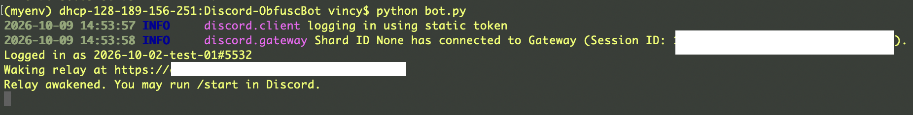

# **Discord ObfuscBot**
## Condition Masking Interface

This is a Discord chatbot tool designed to create a space for hosting experimental chats between a human participant pair or between a human participant and an chatbot. This tool is made to make the experimental conditions blind to the research experimenter as much as possible within the constraints of the Discord environment through tinkering arround the various permissions on Discord. By serving as the sole intermediary between the researcher and the participants, this tool eliminates experimenter bias during live data collection and interaction. This tool draws on the previous tools developed at the UBC Happy Lab by Miras et al. (2026) and Signh (2024).

## Set Up the Study Discord Server: Roles, Categories, and Channels
### Discord Installation & Server Set Up
1. Download Discord  
   * Go to [discord.com/download](https://discord.com/download) and install the desktop app (recommended for the session RA so the bot and Discord can stay open side-by-side). Create or sign in with a lab-owned account. Do not use a personal account.

1. Create a server  
   * In Discord, click the + next to the server list → Create My Own → For me and my friends. Name it something study-specific (e.g., “Capitalization Study”). Turn Community features **off**. Do not enable discovery or a public invite. This server stays private and invite-only.
1. Discord Developer Portal  
   - Go to [discord.com/developers/applications](https://discord.com/developers/applications) and log in with the same lab account.  
   - Click **New Application**, give it a study name (the bot will appear as “Sam” or whatever display name you set), and create it.  
   - On the Bot page:  
     - Reset Token and copy it into your `.env` later (never commit or share it).  
     - Turn **Message Content Intent** and **Server Members Intent** on. Presence Intent stays off. Public Bot stays off.  
   - On the OAuth2 → URL Generator page:  
     - Scopes: tick `bot` and `applications.commands`.  
     - Bot Permissions: View Channels, Send Messages, Manage Channels, Manage Roles.  
       Do **not** tick Read Message History, Administrator, or anything else.  
     - Copy the generated URL, open it, and add the bot **only** to this study server.  
   - Right-click the server icon → Copy Server ID. That number goes in `DISCORD_GUILD_ID`.
  
1. Allow Discord Developer Mode  
   User Settings (gear) → Advanced → turn **Developer Mode** on. This lets you copy channel and server IDs later.

### Create Discord Roles
Create these roles (Server Settings → Roles). Order and permissions matter:

- **Staff** (capital S)  
  No Administrator. Assign only to the lab account and any supervisor who needs to see the staff logs. Never assign to a participant or to the session RA who is running the live session.

- **RA**  
  Can run the slash commands (`/start`, `/stop`, `/status`) but does **not** gain access to the staff-log channels. Other permissions stay off so the channel header does not show a member count.

- **Condition-1**  
- **Condition-2**  

> Note: The study supervisors may want to hide what `Condition-1` and `Condition-2` really are!  
> These are opaque invite roles. `Condition-1` might be used for the AI arm and `Condition-2` for the human arm (mapping lives only with supervisors). Do not hoist the roles and do not give them a colour. The bot itself never reads these roles; it reads the sealed assignment from the relay.

Drag the bot’s role **above** the Staff role. Otherwise channel overwrites fail with a permissions error.

### Create Discord Categories:

Create two categories (exact names):

- **Staff**  
  Deny `@everyone` View Channel. Allow only the Staff role. This is where the bot creates the per-session `#staff-log-<id>` mirrors. The session RA never looks at these.

- **Sessions**  
  Deny `@everyone` View Channel. Also deny the bot role View Channel on the category itself. Participant channels live here and are locked down one by one.

### Create Discord Channels

Create a channel under the **Sessions** category a day in advance for each scheduled slot, for example:

- `#s01` for session 01  
- `#s-pi01` for pilot 01  

On that channel only:

- Deny `@everyone` and deny the Staff role View Channel.  
- Allow the correct lane role (Condition-1 or Condition-2) View Channel, Send Messages, and Read Message History.  
- Allow the bot role View Channel, Send Messages, Read Message History, and Manage Roles (so it can lock itself out at the end).  

Do **not** put the lane roles or the bot role on the Sessions category itself, or every channel on that lane becomes visible. Create the invite from the channel (Edit Invite → attach the lane role, set expiry and max uses) and send that URL through the Qualtrics branch. The person who sends the invites can see one versus two participants; that person should not be the session RA who later interacts with them.


## Script Installation 
1. Download this repo's latest release onto your local machine. The newly saved folder should have the same name as this repo `Discord-ObfuscBot`.
1. Open your machine's Terminal application at the saved `Discord-ObfuscBot` folder.
1. [***Requirements***]
    * Python requirement:
        > - Python 3.14.7: [Installation](https://www.python.org/downloads/)
    * Python package requirements: 
        > - discord.py>=2.4
        > - python-dotenv>=1.0
        > - openai>=1.40
        
        > - fastapi>=0.115
        > - uvicorn>=0.30
        > - pymongo>=4.8
        > - python-dotenv>=1.0

    * [Render] for backend
    * [MongoDB Atlas] for cloud database
        > Randomized participant condition sheet & session data exports storage
        
## How to Run the Bot during the Study
1. Before running the study, ensure that a separate research assistant (RA) has done relaying the conditions for the randomized participants for the current study session (see How to Relay the Conditions section).
1. [***Open Discord***, leave it open]
1. [***Activate environment for python scripts***]
1. Copy and paste the following command into your Terminal and press **Enter** on your keyboard: 
    > ```
    > python bot.py
    > ```
1. Wait until a `Relay awakened. You may run /start in Discord` message shows up in the Terminal interface:
   
1. [Switch back to Discord]
1. [Confirm with the participants that they've completed the Qualtrics intake form, which contains their customized Discord channel link for their pre-randomized condition.]
1. [When ready, start the chat by typing in the slash command `/start` and fill in the `session_id` and `minutes` fields.
   > * `minutes` sets a timer for the chat.
   > * If `minutes` has been set to 10, the following message will pop up in the Discord channel after `/start`:
   >   
   >   ```
   >   Time left: 7:59 of 8:00. The conversation ends when this reaches 0:00.
   >   ```


> ***🚧 Instruction still in progress 🚧 ***


## Reference
Miras, P., Lu, M., & Gong, B. (2026). *chatbot-backend*. GitHub. https://github.co (Private repository).

Signh, A. (2024). *UBC-Discord-Bot*. GitHub. https://github.com/wwbp/UBC-Discord-Bot/


## License
[![CC BY-NC 4.0][cc-by-nc-shield]][cc-by-nc]

The codebase is licensed under a
[Creative Commons Attribution-NonCommercial 4.0 International License][cc-by-nc].

[![CC BY-NC 4.0][cc-by-nc-image]][cc-by-nc]

[cc-by-nc]: https://creativecommons.org/licenses/by-nc/4.0/
[cc-by-nc-image]: https://licensebuttons.net/l/by-nc/4.0/88x31.png
[cc-by-nc-shield]: https://img.shields.io/badge/License-CC%20BY--NC%204.0-lightgrey.svg
